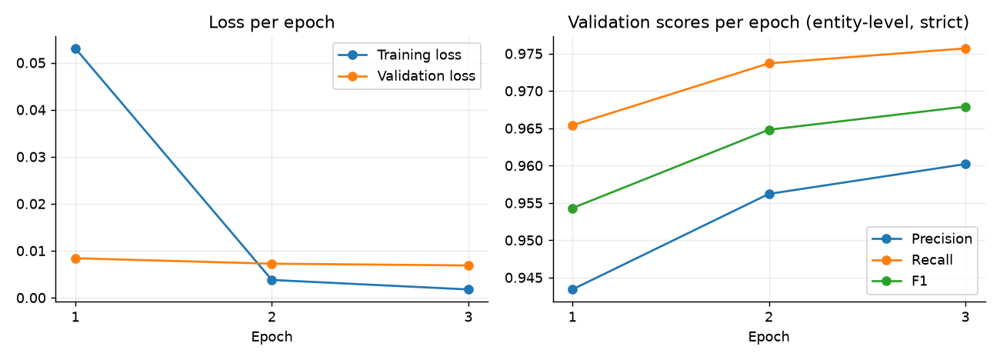
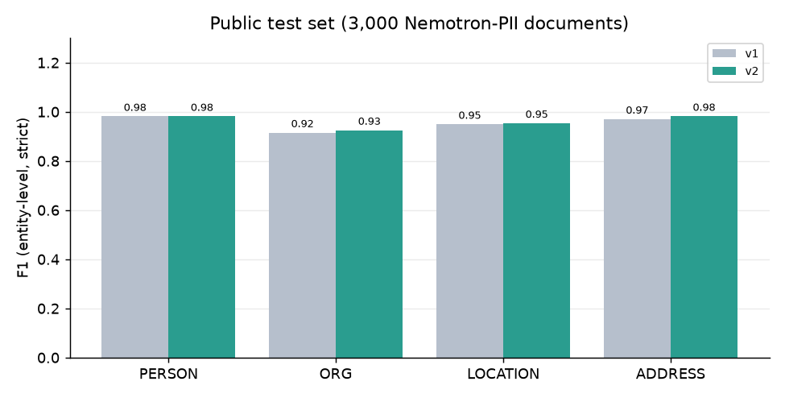
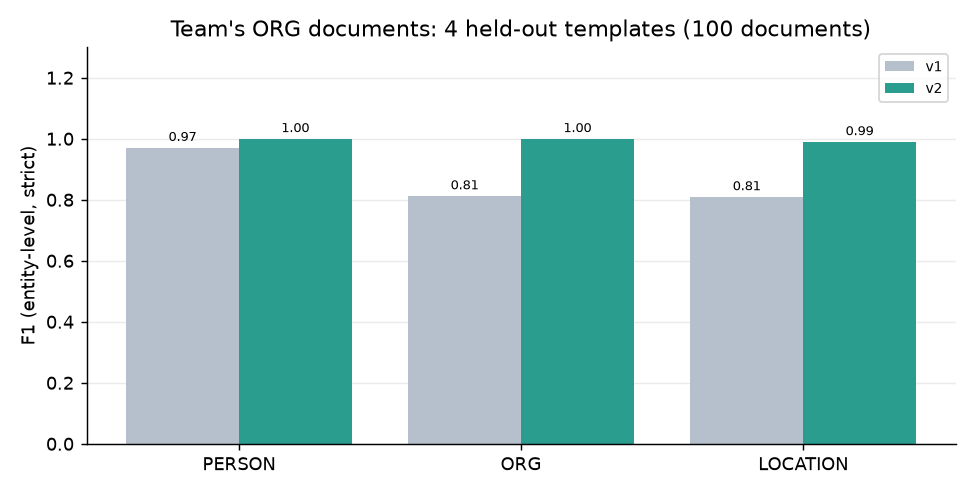
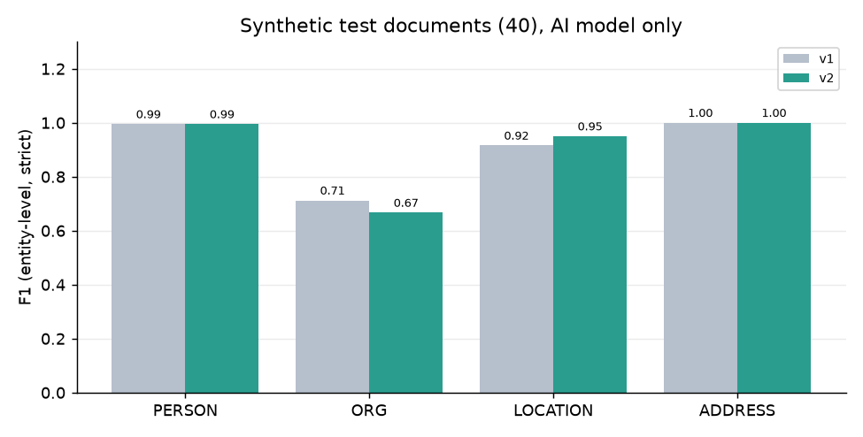

# Dataset Update: The Team's ORG Documents and Model Version 2

This document explains what was done with the extra dataset the team gathered on
26 November 2026: how it was checked, what was wrong with it, how it was cleaned and organised,
how it was used to train and test the model, and what changed in the project.

## 1. Summary

- **The file.** It holds our own 20,000 prepared training documents plus **500 new documents**
  written by the team. Only the 500 new documents are new data. Nothing in the file leaks into our
  test data.
- **Valid, with three problems that were fixed.** The labels that exist are correct, but only
  company names were labelled (475 person names and 325 cities were not), and the 500 documents are
  20 templates repeated 25 times with different company names. The missing labels were added, and
  the documents were split by template: 350 for training, 50 for validation, 100 for testing.
- **Model version 2.** The model was retrained on the Nemotron documents plus the 350 training
  documents. Two settings were tried; the choice was made on validation data only, with a rule
  written down before any result was seen.
- **Results on the test sets (version 1 -> version 2):**

| Test set | What it measures | v1 | v2 |
|---|---|---|---|
| Nemotron-PII test, 3,000 documents | Overall F1 of the AI model | 0.956 | **0.961** |
| | ORG F1 | 0.915 | **0.925** |
| Team's documents, 4 held-out templates (100) | ORG F1 | 0.813 | **1.000** |
| Synthetic test documents (40), complete pipeline | Overall F1 | 0.949 | **0.950** |
| | ORG F1 | **0.703** | 0.667 |

**In one sentence:** version 2 is slightly better on the public test set and much better on
business documents like the team's, but it did **not** fix the main ORG weakness: institutions
and companies written in other styles are still missed as often as before (on the 40 synthetic
documents it finds 24 of 42 organisation mentions, against 26 for version 1).

## 2. What was received

| | |
|---|---|
| File | `train_with_org_augmented.jsonl` (28 MB, 20,500 rows, JSON Lines) |
| SHA-256 | `2344ad8dd46232822cf5284eacfc7817bdc53fdd0c38b987af42dcd86cacc04f` |
| Described as | "our dataset with an extra 500 entries to improve the ORG recognition", not tested yet |
| Columns | the same as our prepared files: `uid`, `domain`, `document_type`, `document_format`, `locale`, `text`, `entities`, `regex_entities` |

The team also noted three public datasets it had looked at (ai4privacy OpenPII 1.5M, Few-NERD
and Gretel PII masking v1) and concluded that Nemotron-PII still covers the bigger picture best.
Their notes are recorded in the data-sources document (Part 2 of the project record).

## 3. Assessment

### 3.1 What the 20,500 rows are

The file is **not** the full 200,000-row Nemotron-PII dataset. It is our prepared training split
(`data/processed/train.jsonl`, 20,000 documents) plus 500 new documents at the end.

| Rows | Same `uid` as our training split? | Same content? | Origin |
|---|---|---|---|
| 18,043 | yes | yes, identical | Nemotron-PII training file |
| 1,957 | yes | **no**: different text, labels and locale | Nemotron-PII training file (the "sister" version, see below) |
| 500 | no | new | written by the team |

**Why 1,957 rows differ.** Nemotron-PII stores every document `uid` twice: once in a US version and
once in an international version, with different text. For these 1,957 documents the file contains
the other version. All of them come from the dataset's *training* file, and none of their texts is
in our validation or test files, so **nothing leaks into the test data**.

**Decision.** We keep our own `train.jsonl` and add only the 500 new documents. Reasons:
script 01 can rebuild our file exactly; and with the same 20,000 documents, the 500 new documents
are the only difference between the old and the new model, so any change in the scores can be
explained by them.

### 3.2 The 500 new documents

| Check | Result |
|---|---|
| Format and offsets (every label points to real text, no spaces at the edges, no overlaps) | all valid |
| Duplicate texts or ids | none |
| Same text or id as a Nemotron document (train, validation or test) | none |
| Same names as our synthetic test documents | none |
| Length | 306 to 522 characters, average 389 (Nemotron-PII documents: average 980, median 759) |
| Language, locale | English, all "intl" |
| Domains | 10, with 50 documents each (Technology, Healthcare, Finance, ...) |
| Labels | `ORG` only: 1,550 company-name mentions, 500 different company names |

Three problems were found:

1. **Only company names are labelled.** The same documents contain person names ("Contact
   Person: Sarah Mitchell") and cities ("Registered Office: Riyadh") without labels. In training,
   an unlabelled name counts as "not sensitive", so the model would learn that "Sarah Mitchell" is
   *not* a person, which would hurt the PERSON and LOCATION results.
2. **Little variety in the sentences.** The documents come from 20 templates with 25 documents
   each. Inside a template, the text is exactly the same; only the company names (and in three
   templates the domain word) change. So the 500 documents contain 20 different texts, not 500.
3. **Company names repeat in families.** The 500 names are built from 50 first words ("Aster",
   "Safa", "Al Noor", ...) with 10 endings each ("Aster Technologies", "Aster Networks", ...).

### 3.3 Is it valid and useful?

Yes, with the fixes in Section 4. The labels that exist are correct, the data is fictional, and it
adds what Nemotron-PII lacks: company names that look Middle Eastern ("Al Manar", "Takaful",
"Riyadh ...") and short business forms with "Supplier:", "Billed To:" and similar fields. It is
small compared to Nemotron-PII: its 350 training documents add 1,125 ORG labels to the 17,063
already there (+7%).

## 4. Processing: how the data was cleaned and organised

New code: `src/org_supplement.py`, run with `python scripts/05_prepare_org_supplement.py`.
It follows the same workflow as the main data pipeline.

| Step | What happens | Result |
|---|---|---|
| Load | Read `data/extra/org_supplement_raw.jsonl` (the 500 new rows only) | 500 documents |
| Validate | Keys, offsets, labels, overlaps, duplicates, overlap with every Nemotron split | 0 problems |
| Clean | Drop duplicates, documents already in the Nemotron data, texts over 6,000 characters | 0 removed |
| Complete labels | Label the 7 person names and 12 cities that occur in the templates, wherever they appear as a whole word outside a company name | +475 PERSON, +325 LOCATION |
| Split by template | Whole templates go to one split; seed 303; each split gets structured and unstructured documents | train 350 / validation 50 / test 100 |
| Export | `data/processed/org_supplement_train.jsonl`, `_validation.jsonl`, `_test.jsonl` | 3 files |
| Summary | `reports/metrics/org_supplement_summary.json` | |

**How the missing names were found.** Because every template's text is fixed, reading one document
of each of the 20 templates shows every name. The lists are in `config/config.yaml`
(`org_supplement.person_names` and `location_names`). Regions such as "Europe and Middle East" are
not labelled, because Nemotron-PII does not label regions either. Titles ("Ms.", "Dr.") are not part
of the name, as in Nemotron-PII. A city inside a company name ("Riyadh" in "Riyadh Smart
Services") stays part of the company name; a test checks this.

**Why split by template.** With a random split, test documents would contain sentences the model
had already seen in training, with only the company name changed. Holding out whole templates means
the test sentences are new to the model.

| Split | Templates | Documents | ORG | PERSON | LOCATION |
|---|---|---|---|---|---|
| Train | 14 | 350 | 1,125 | 375 | 250 |
| Validation | Customer Support Exchange, Service Agreement | 50 | 150 | 50 | 25 |
| Test | Business News Summary, Internal Memo, Invoice, Research Report | 100 | 275 | 50 | 50 |

Known limit of this test split: the 50 name families appear in every split, so a test name such as
"Aster Cloud Services" is new, but its first word "Aster" was seen in training. The test sentences
are new; the name families are not. The independent checks are the Nemotron test set and our
synthetic test documents, which share nothing with this dataset.

## 5. Training

The training code was extended so that extra files can be added to the Nemotron training data
(`model.extra_train_files` and `model.extra_train_repeat` in the config). Everything else was kept
as for version 1: `distilbert-base-cased`, 3 epochs, learning rate 5e-5, batch size 16, seed 42,
best epoch chosen on the Nemotron validation split.

Two candidates were trained on the RTX 3050:

| Candidate | Supplement documents per epoch | Training documents | Text windows | Minutes |
|---|---|---|---|---|
| `v2_repeat1` | each of the 350 once | 20,350 | 31,817 | 16.1 |
| `v2_repeat3` | each of the 350 three times (more weight on ORG) | 21,050 | 32,517 | 18.2 |

Training of the chosen model (`v2_repeat1`), with version 1 for comparison:

| Epoch | Train loss | Validation loss | Validation F1 (v2) | Validation F1 (v1) |
|---|---|---|---|---|
| 1 | 0.0531 | 0.0084 | 0.9543 | 0.9529 |
| 2 | 0.0038 | 0.0072 | 0.9648 | 0.9580 |
| 3 | 0.0018 | 0.0069 | **0.9679** | 0.9657 |

## 6. Choosing the model (validation data only)

The rule was written down before any result was seen (Project Log, Section 13.2):

1. Only validation data is used: Nemotron validation (2,000), supplement validation (50 documents,
   two unseen templates) and synthetic dev (20).
2. A candidate is allowed only if its overall F1 on Nemotron validation is at most 0.005 lower
   than version 1's.
3. Among allowed candidates, the one with the highest average ORG F1 on supplement validation and
   synthetic dev is chosen.
4. It replaces version 1 only if that average is higher than version 1's.

| Model | Nemotron validation, overall F1 | ORG F1, supplement validation | ORG F1, synthetic dev | Average ORG F1 |
|---|---|---|---|---|
| v1 | 0.9657 | 0.864 | 0.844 | 0.854 |
| v2_repeat1 | **0.9679** | 1.000 | 0.864 | **0.932** |
| v2_repeat3 | 0.9658 | 1.000 | 0.864 | **0.932** |

Both candidates pass the Nemotron check. They have exactly the same ORG average, which the rule did
not foresee. The tie was broken **before any test set was run**, with another validation number:
the higher Nemotron validation F1. That chooses `v2_repeat1`, which is also the simpler setting.
Its ORG average (0.932) is higher than version 1's (0.854), so it became **version 2**, the model
the app now uses (`models/privacylens-ner/`).

Using the documents three times did not help: it gave the same ORG scores and a slightly lower
Nemotron score. The two candidates differ by 0.002 on Nemotron validation with almost the same
data, which shows the size of the normal run-to-run variation.

## 7. Test results

The test sets were run once, after the choice, for version 1 and version 2
(`python scripts/06_compare_models.py --stage test ...`, results in
`reports/metrics/model_comparison_test.json`). All numbers are strict: the category and both ends
of the item must match.

### 7.1 Public test set (3,000 Nemotron-PII documents)

| Category | v1 precision | v1 recall | v1 F1 | v2 precision | v2 recall | v2 F1 | Items |
|---|---|---|---|---|---|---|---|
| PERSON | 0.981 | 0.983 | 0.982 | 0.983 | 0.981 | 0.982 | 2,936 |
| ORG | 0.905 | 0.926 | 0.915 | 0.910 | 0.942 | **0.925** | 1,667 |
| LOCATION | 0.940 | 0.960 | 0.950 | 0.949 | 0.959 | 0.954 | 1,868 |
| ADDRESS | 0.969 | 0.973 | 0.971 | 0.979 | 0.985 | 0.982 | 475 |
| **Overall** | 0.951 | 0.962 | 0.956 | 0.955 | 0.966 | **0.961** | 6,946 |

Share of sensitive characters covered: 96.8% -> 97.3%. Every category is equal or better. The
gains are small (+0.004 overall, +0.010 for ORG); part of them may be normal run-to-run variation
(Section 6).

### 7.2 The team's documents (100 documents, 4 templates never used in training)

| Category | v1 F1 | v2 F1 | Items |
|---|---|---|---|
| PERSON | 0.971 | 1.000 | 50 |
| ORG | 0.813 | **1.000** | 275 |
| LOCATION | 0.810 | 0.990 | 50 |
| **Overall** | 0.835 | **0.999** | 375 |

Version 2 finds every company name in these documents. This number is **optimistic**: the
sentences are new, but the documents are short, regular business forms, and the first word of
every company name ("Aster", "Safa", ...) was seen in training. It shows that the model learned this
kind of document. It does not show that it learned organisations in general.

### 7.3 Synthetic test documents (40 fictional letters, CVs, forms, chats)

| | v1 | v2 |
|---|---|---|
| Complete pipeline: precision / recall / F1 | 0.956 / 0.943 / 0.949 | 0.965 / 0.936 / **0.950** |
| Share of sensitive characters covered | **94.5%** | 93.7% |
| ORG: precision / recall / F1 | 0.812 / 0.619 / **0.703** | 0.800 / 0.571 / 0.667 |
| LOCATION F1 | 0.916 | **0.950** |
| PERSON, ADDRESS and all rule categories | unchanged | unchanged |

On these documents version 2 finds 24 of the 42 organisation mentions, version 1 found 26:

| Document | Organisation | v1 | v2 |
|---|---|---|---|
| doc_019, doc_050 | Harbor Point Bank | found | missed (only "Harbor Point" or nothing) |
| doc_017 | Blue Falcon Logistics | found | missed |
| doc_037 | Red Sea Analytics | missed | found |
| doc_003 | Red Sea Analytics | missed | missed |

The difference is small (two mentions; "Harbor Point Bank" counts twice), but it goes the wrong
way and is reported as it is. The 42 mentions come from only 14 different organisation names, so
one name that is missed in several documents moves the score a lot. The names that both versions
miss are institutions and agencies: "Al Waha Medical Center", "Eastern Dunes Academy" and "Oasis
Travel Agency". Fewer false alarms (precision up) explain why the overall F1 still
rose slightly.

### 7.4 Examples tried by hand

The sentences from the weak-points document were run through both models:

| Text | v1 | v2 |
|---|---|---|
| "...booked through Oasis Travel Agency in Jeddah." | "Oasis" only | **"Oasis Travel Agency"** |
| "Intern at Red Sea Analytics" | "Analytics" | "Sea Analytics" (still incomplete) |
| "...Imam Abdulrahman Bin Faisal University... King Fahd Hospital in Dammam." | only "Dammam" | only "Dammam", and "King Fahd" wrongly as ADDRESS |
| "...the front desk of Al Waha Medical Center..." | nothing | nothing |
| "please contact ahmed alqahtani or sara alharbi at the riyadh office." | nothing | nothing |
| "Gulf Horizon Trading Company and Najd Steel Industries ... Riyadh ... Khalid Al-Mutairi" | all found | all found |

## 8. What changed in the project

**Model**

| | |
|---|---|
| `models/privacylens-ner/` | Now version 2 (`v2_repeat1`). Version 1 stays available in the Git history (first commit) and, on the computer that trained it, in `models/archive/` (not uploaded). |

**Data**

| File | Change |
|---|---|
| `data/extra/org_supplement_raw.jsonl` | New: the 500 team documents as received (the 20,000 Nemotron rows of the received file are not copied, because they are already in `data/processed/train.jsonl`) |
| `data/processed/org_supplement_train.jsonl`, `_validation.jsonl`, `_test.jsonl` | New: 350 / 50 / 100 documents with completed labels |

**Code**

| File | Change |
|---|---|
| `src/org_supplement.py` | New: load, validate, clean, complete labels, split by template, export |
| `scripts/05_prepare_org_supplement.py` | New: runs that pipeline |
| `scripts/06_compare_models.py` | New: compares model folders, validation stage and test stage kept apart |
| `src/train_ner.py` | Reads extra training files (`model.extra_train_files`, `model.extra_train_repeat`); experiments do not overwrite the report files |
| `scripts/02_train_model.py` | Options `--output-dir`, `--extra-repeat`, `--no-extra` |
| `scripts/04_evaluate.py` | New part C: the model on the team's held-out templates |
| `src/pipeline.py` | `scan(..., model=...)` to run the app's workflow with another model |
| `src/evaluation.py` | `load_synthetic` moved here (used by scripts 04 and 06) |
| `src/visualization.py` | Comparison chart accepts a title and colours |
| `config/config.yaml`, `config.example.yaml` | New `org_supplement` section and the two training options |
| `.gitignore` | `models/archive/` and `models/experiments/` are not uploaded |
| `tests/test_org_supplement.py`, `tests/test_ner_detector.py` | 13 new tests (122 in total, all pass, none skipped) |

**Results and documents**

| File | Change |
|---|---|
| `reports/metrics/` | `org_supplement_summary.json`, `model_comparison_validation.json`, `model_comparison_test.json` (new); `evaluation_results.json`, `training_history.json` and the error tables now describe version 2; version 1's files are kept in `reports/metrics/v1/` |
| `reports/figures/` | 06 to 11 redrawn for version 2; 13, 14 and 15 are new (v1 against v2) |
| `reports/logs/` | Training logs of both candidates and the evaluation log of version 2 |
| Documents | This document (new PDF 4); README, model card, project log (Section 13), project record, data sources, code guide, weak points, run guide, report draft and AI usage report updated |

## 9. Limits and next steps

### 9.1 Limits of this update

- **20 sentence patterns.** However many documents the templates produce, the model sees only
  20 different texts. More documents from the same 20 templates would add little.
- **Company names only.** No university, hospital, ministry or school names, which are the names the
  model misses most (Weak Points, Section 2.1).
- **One training run per setting.** Differences of about 0.002 to 0.004 can come from chance.
- **The team's test split is optimistic** (Section 7.2).
- **Who made the documents and how is not recorded yet.** `TO COMPLETE` by the team in the data
  sources document (Section 5b), because the course asks for the source of every dataset.

### 9.2 Found on the way (also true for version 1)

Nemotron-PII has two versions of every document `uid`. Our script 01 split the training file by
row, so for **420 of the 2,000 validation documents** the other version of the same document is in
the training split. The test split is not affected (it comes from the dataset's separate test
file, which shares no `uid` with the training file). The validation scores may therefore be
slightly optimistic. Fix for a future rebuild: split by `uid` instead of by row in
`src/data_preparation.py` (`transform`).

### 9.3 What would help organisations most

1. **More varied sentences, not more copies.** If the team writes more documents, write new
   templates (several people writing differently) rather than more names for the same templates.
2. **Institutions.** Add documents with universities, hospitals, ministries, schools and
   "Medical Center" / "Travel Agency" style names, labelled completely (people and places too).
3. **Few-NERD** (the team's own note): its fine-grained organisation labels (company, education,
   government, media, sports teams, ...) on Wikipedia sentences are exactly the variety that is missing.
   Check the licence, map its organisation types to `ORG`, add a few thousand sentences with
   `extra_train_files`, and choose with `scripts/06_compare_models.py --stage validation`.
4. **Label every name.** Any new document must label all people, organisations and places in it,
   not only the ones it was written for (Section 3.2, problem 1).
