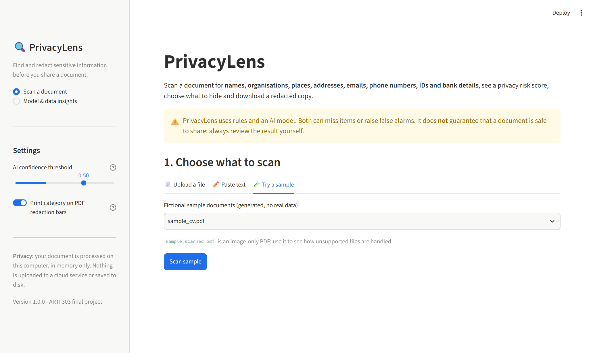
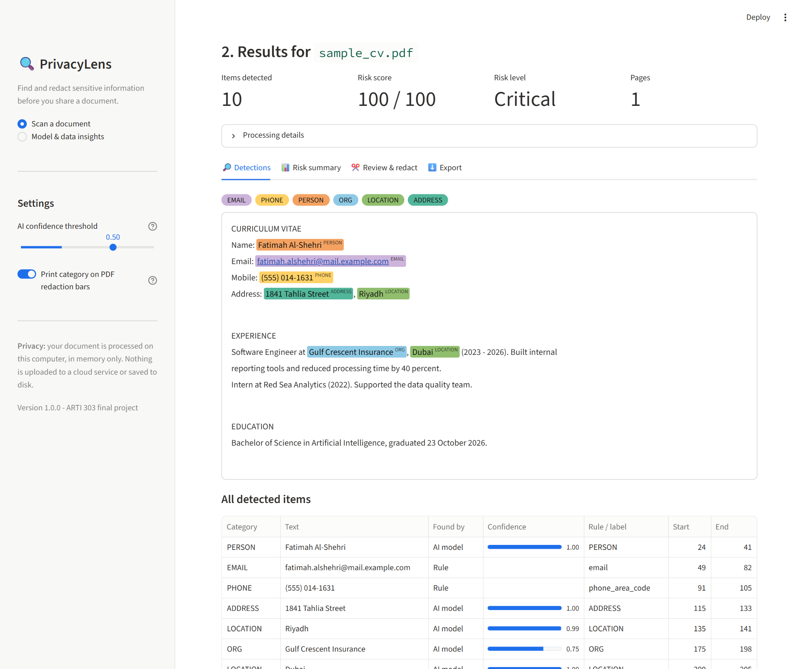
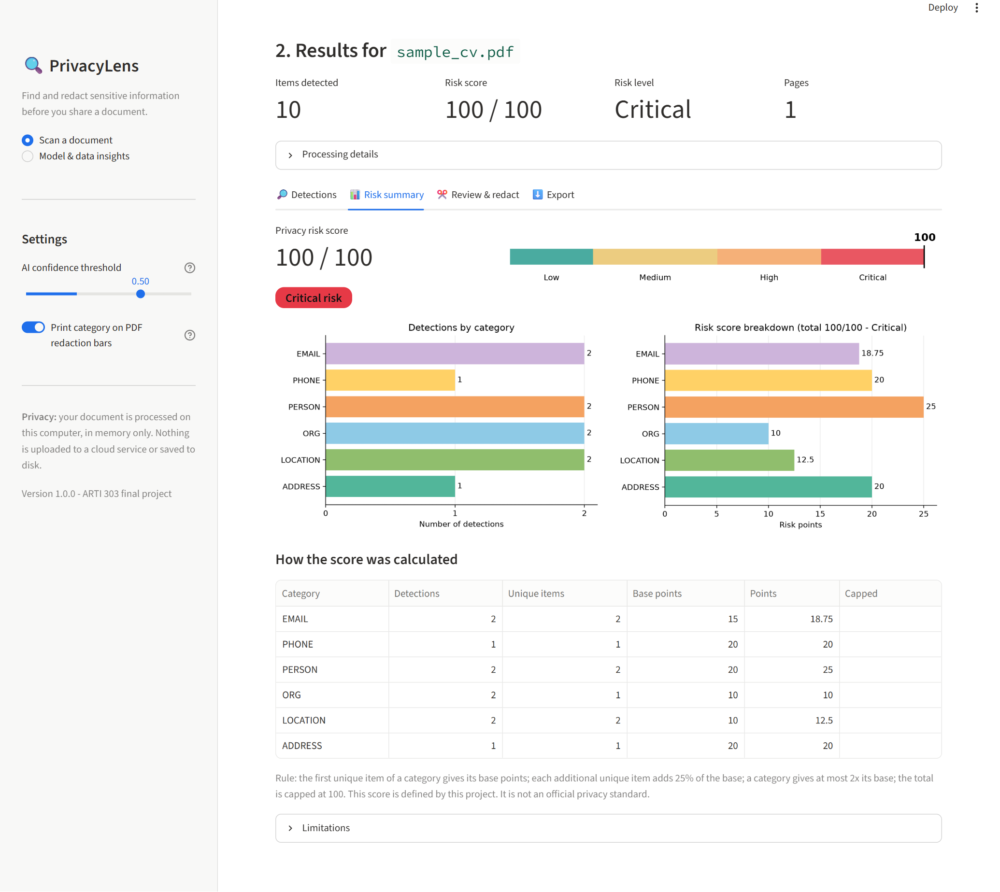
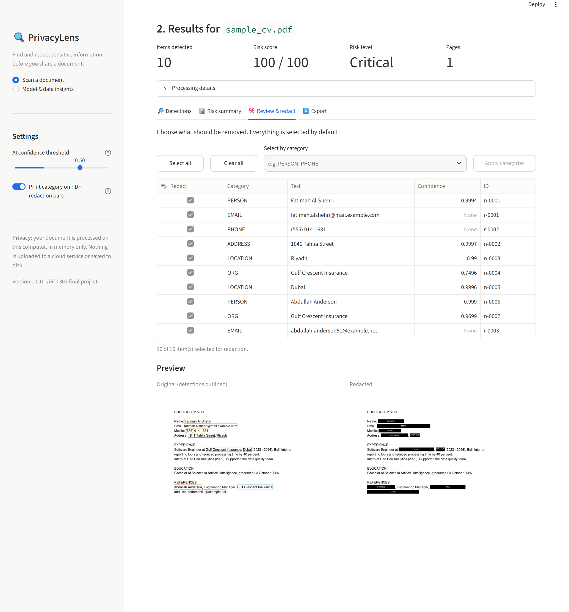
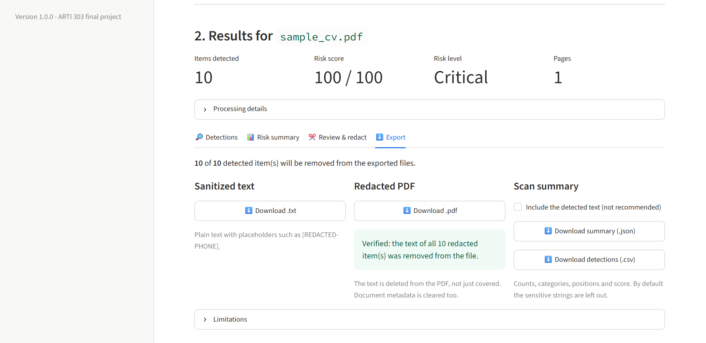

# How to Run PrivacyLens

PrivacyLens runs on your own computer and opens in your web browser.
Your documents stay on the computer: nothing is uploaded to a website.

Choose the section that fits you:

| You are... | Go to |
|---|---|
| On the laptop where the project was built | Section 1 |
| On another computer, or cloning the GitHub repository (teammate, instructor, new user) | Section 2 |
| Already running the app and want to know how to use it | Section 3 |
| A developer who wants to rebuild the data, model and results | Section 4 |
| Stuck with an error | Section 5 |

## 1. On the laptop where the project was built

Everything is already installed here.

**Easiest way:** open the project folder and double-click **`run_app.bat`**.
A black window opens, and a few seconds later your browser shows the app.

**Or with a command.** Open the project folder in File Explorer, click the address bar,
type `powershell`, press Enter, and run:

```
& "$HOME\.venvs\privacylens\Scripts\python.exe" -m streamlit run app.py
```

(On this laptop the Python environment lives outside the project, in the `.venvs\privacylens`
folder of your user folder. `run_app.bat` finds it automatically.)

Then open **http://localhost:8501** in your browser.
With the command, the browser does not open by itself; with `run_app.bat` it does.

**To stop the app:** press `Ctrl+C` in the black window, or close that window.

Keep the black window open while you use the app. It is the program; the browser only shows it.

## 2. On another computer

This was tested on 16 November 2026 with a completely new environment on Windows 11:
the installation took about 8 minutes, used about 1.3 GB of disk space, and all tests (109 at
that time) passed without a graphics card. It was not tested on macOS or Linux.

### What you need

- Windows, macOS or Linux
- **Python 3.12 or newer** (the project was built with Python 3.14). Download: https://www.python.org/downloads/.
  On Windows, tick **"Add python.exe to PATH"** in the installer.
- **Git with Git LFS**. Git for Windows (https://git-scm.com) already contains Git LFS.
  On macOS / Linux install Git LFS from https://git-lfs.com.
- About 2 GB of free disk space and an internet connection for the installation
- A graphics card is **not** needed to use the app

### Step 1: get the project and open a terminal in it

Open a terminal (Windows: PowerShell; macOS / Linux: Terminal) in the folder where you keep your
projects, and run (use the repository address your team gave you):

```
git lfs install
git clone <repository address>
cd <repository folder>
```

`git lfs install` is needed only once per computer. It makes Git download the 250 MB model
file together with the code.

If you received the project folder as a copy instead: Windows: open the folder in File Explorer,
click the address bar, type `powershell`, press Enter. macOS / Linux: open Terminal and use `cd`
to go to the folder.

### Step 2: create a private Python environment (one time)

```
python -m venv .venv
```

### Step 3: install the libraries (one time, about 8 minutes)

Windows:

```
.venv\Scripts\python.exe -m pip install -r requirements.txt
```

macOS / Linux:

```
.venv/bin/python -m pip install -r requirements.txt
```

### Step 4: check the AI model

The trained model is the folder `models/privacylens-ner`. Its main file, `model.safetensors`,
should be about **250 MB**.

| Situation | What to do |
|---|---|
| `model.safetensors` is about 250 MB | Nothing. You are ready. |
| `model.safetensors` is only about 1 KB | Git LFS was not active when you cloned. Run `git lfs install`, then `git lfs pull`. |
| The folder `models/privacylens-ner` is missing (for example in a copy without the model) | Copy it from a teammate, or train it yourself: see Section 4 (about 17 minutes with an NVIDIA graphics card). |
| You still have no model | The app starts anyway. It downloads a weaker public model, tells you so on screen, and does not detect street addresses. |

### Step 5: start the app

Windows: double-click **`run_app.bat`**, or run:

```
.venv\Scripts\python.exe -m streamlit run app.py
```

macOS / Linux:

```
.venv/bin/python -m streamlit run app.py
```

Then open **http://localhost:8501** in your browser.

From now on, only Step 5 is needed.

## 3. Using the app

### 3.1 Choose what to scan



There are three ways to give the app a document:

- **Upload a file**: a PDF or a TXT file, up to 20 MB and 200 pages. The PDF must contain real
  text. A scanned PDF (photos of pages) is refused with a clear message.
- **Paste text**: copy any text and paste it in the box.
- **Try a sample**: pick one of the fictional sample documents. Start here the first time.

Then press the blue **Scan** button. The first scan takes a few seconds longer because the AI
model is loaded.

The left side has two settings:

- **AI confidence threshold**: how sure the model must be before it reports a name or place.
  Lower finds more but gives more false alarms. Leave it at 0.50 unless you have a reason.
- **Print category on PDF redaction bars**: writes the category (for example PERSON) in white
  on each black bar.

### 3.2 Detections



The four numbers at the top give the overview. Below, the text is shown with every detected item
highlighted in the colour of its category, followed by a table of all items. "Found by" tells you
whether a rule or the AI model found the item.

### 3.3 Risk summary



The risk score goes from 0 to 100 and has four levels: Low, Medium, High and Critical.
The table shows exactly how the score was calculated. The score is a simple indicator defined by
this project. It is not an official or legal assessment.

### 3.4 Review and redact



Everything is selected at the start. Untick the items you want to keep visible, or use
**Select all**, **Clear all** and **Select by category**. The preview shows the original on the
left and the redacted result on the right.

**Read the preview carefully.** If something sensitive is still visible on the right, the app did
not detect it. The app cannot remove what it did not detect.

### 3.5 Export



| Download | What it is |
|---|---|
| **Sanitized text (.txt)** | The text with placeholders such as `[REDACTED-PHONE]` |
| **Redacted PDF (.pdf)** | A new PDF where the selected text is deleted from the file, not just covered. The green message confirms that the app checked this. Only available when you scanned a PDF. |
| **Summary (.json)** and **detections (.csv)** | A record of the scan: counts, categories, positions and the score. The sensitive words themselves are left out unless you tick the box. |

### 3.6 The second page: Model & data insights

Choose **Model & data insights** on the left to see the dataset statistics, the training history
and the test results of the model. This page is useful for the presentation.

### 3.7 Good to know

- English text only. Arabic text is not analysed (numbers such as phone numbers are still found).
- Scanned documents and text inside pictures are not analysed.
- The app can miss items. Always read the result before you share a document.
- Typical speed without a graphics card: under 1 second for a few pages, about 4 seconds for
  20 pages of text, about 30 seconds for a very long document (200,000 characters).

## 4. For developers: rebuild everything

Run these from the project folder with the Python of your environment
(for example `.venv\Scripts\python.exe` in place of `python`).

| Order | Command | What it does | Time |
|---|---|---|---|
| 1 | `python scripts/01_prepare_data.py` | Downloads the dataset (300 MB), checks, cleans, explores and exports it. Optional: the prepared data is already in the repository. | about 1 minute plus download |
| 2 | `python scripts/05_prepare_org_supplement.py` | Checks the team's 500 ORG documents, completes their labels and splits them by template. Optional: the prepared files are already in the repository. | seconds |
| 3 | `python scripts/02_train_model.py` | Trains the AI model (Nemotron-PII + the team's documents). Optional: the trained model is already in the repository. Add `--output-dir models/experiments/<name>` to train a trial model without replacing the app's model. | about 17 minutes on an RTX 3050 |
| 4 | `python scripts/03_make_synthetic_docs.py` | Creates the fictional test documents and the sample files | seconds |
| 5 | `python scripts/04_evaluate.py` | Calculates all results, charts and error tables | about 3 minutes |
| 6 | `python scripts/06_compare_models.py --stage validation --model old=<folder> --model new=<folder>` | Compares two trained models on validation data (to choose one); `--stage test` reports the test results once the choice is made | about 1 minute per model |
| 7 | `python -m pytest` | Runs the 122 automated tests | under 1 minute |
| 8 | `python scripts/build_pdf_docs.py` | Rebuilds the four PDF documents in `docs/pdf` | seconds |

**Training needs a graphics card to be fast.** The normal installation gives the CPU version of
PyTorch. For an NVIDIA card, install the GPU version first, then the rest:

```
.venv\Scripts\python.exe -m pip install torch==2.14.1 --index-url https://download.pytorch.org/whl/cu126
.venv\Scripts\python.exe -m pip install -r requirements.txt
```

Training without a graphics card works but was not timed; expect hours instead of minutes.

All settings (sizes, limits, model options, risk weights) are in `config/config.yaml`.

## 5. If something goes wrong

| What you see | Cause | What to do |
|---|---|---|
| `python` is not recognized | Python is not installed, or not on the PATH | Install Python and tick "Add python.exe to PATH". Then open a new terminal. |
| `No module named streamlit` | The libraries are not installed in the Python you used | Repeat Step 3 of Section 2, and start the app with the same `.venv` Python. |
| The browser shows "This site can't be reached" | The app is not running, or still starting | Check that the black window is open. Wait 10 seconds and reload the page. |
| The page opens at a different address | Port 8501 is used by another program | Look in the black window for the line "Local URL" and open that address. |
| A message that a fallback model is used | The model folder is missing, or `model.safetensors` is only a 1 KB placeholder | See Step 4 of Section 2 (`git lfs pull`). |
| "Scanned PDFs are not supported" | The PDF contains pictures of pages, not text | Use a PDF that was saved from Word or another program, not a scan. |
| "Unsupported file type" | The file is not PDF or TXT | Save the document as PDF, or paste its text. |
| Text looks shifted next to a black bar in the redacted PDF | A newer PyMuPDF version is installed | Run `pip install PyMuPDF==1.26.7` with the project's Python. |
| Installation fails with a version error | The Python version is older than 3.12 | Install a newer Python and create the `.venv` again. |
| Windows asks about firewall access | Normal for a local web app | You can choose "Cancel". The app still works on your own computer. |
| The first scan is slow | The AI model is loading | Normal. Later scans are fast. |

## 6. Privacy when running the app

- The app runs on your computer. Documents are processed in memory and are not saved by the app.
- The log file (`outputs/logs/privacylens.log`) contains counts and events only, never the text.
- An internet connection is needed only to install the libraries, and to download a model if the
  trained model folder is missing.
