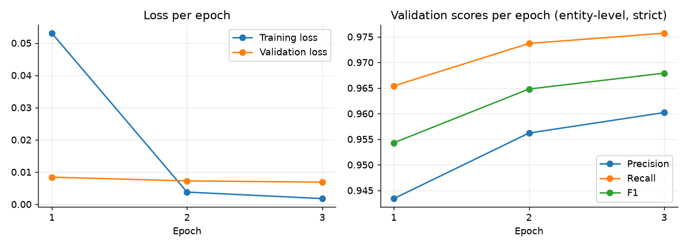

# Overview of the Work

This document is the complete record of how PrivacyLens was built: what was done, in which
order, why each decision was taken, where the data and models come from, and how the code works.
It has five parts.

| Part | Content | Read it when you want to... |
|---|---|---|
| 1. Overview of the Work (this part) | The whole project on a few pages | get the big picture |
| 2. Data and Model Sources | Dataset, models, licences, citations | cite sources or answer "where does the data come from?" |
| 3. Project Log | Every step and decision in the order it happened | understand why something was done |
| 4. Code Guide | Every code file explained, linked to the lectures | explain the code |
| 5. Model Card | Facts about the trained model and its results | present the model |

Three companion documents are separate files: **How to Run PrivacyLens**,
**Weak Points and Improvements**, and **Dataset Update** (the team's extra ORG documents and
model version 2).

## 1. The project in short

PrivacyLens is the ARTI 303 final project. It scans pasted text, TXT files and text-based PDFs
for sensitive information, shows a privacy risk score, lets the user choose what to hide, and
exports a sanitized text file and a redacted PDF in which the selected text is deleted.

It finds nine categories with two methods:

| Method | Categories | Why this method |
|---|---|---|
| An AI model trained in this project | PERSON, ORG, LOCATION, ADDRESS | Names have no fixed format; a model reads the context |
| Rules (regular expressions) | EMAIL, PHONE, ID_LIKE, CREDIT_CARD, IBAN | These follow fixed formats; rules are exact and easy to explain |

## 2. What was produced

| Item | Where | Size |
|---|---|---|
| Application (Streamlit, two pages) | `app.py` | 619 lines |
| 15 code modules | `src/` | about 3,300 lines |
| 6 workflow scripts (data, training, test documents, evaluation, team's ORG documents, model comparison) | `scripts/` | |
| 122 automated tests | `tests/` | all pass |
| Trained AI model, version 2 | `models/privacylens-ner/` | 250 MB |
| Prepared dataset: 20,000 / 2,000 / 3,000 documents | `data/processed/` | |
| The team's ORG documents: 350 / 50 / 100 | `data/extra/`, `data/processed/` | |
| 60 fictional test documents with correct answers, 5 sample files | `data/synthetic/`, `data/gold/`, `data/samples/` | |
| 11 charts, 6 app screenshots | `reports/figures/`, `reports/screenshots/` | |
| Results and error tables | `reports/metrics/` | |
| Documentation | `README.md`, `docs/`, `AI_USAGE_REPORT.md` | |

## 3. The work in order

Steps 1 to 12 were done on 16 November 2026, step 13 on 24 November 2026 and step 14 on
26 November 2026. Details and reasons are in Part 3 (Project Log).

| # | Step | What was done | Result |
|---|---|---|---|
| 1 | Read the material | Course guidelines, Plan v2 and lectures 1 to 14 | Decision to fine-tune a small pretrained model with a plain PyTorch loop, using only taught techniques |
| 2 | Set up the environment | Python 3.14, virtual environment, PyTorch with GPU support | Training possible on the laptop's RTX 3050 |
| 3 | Choose the dataset | Compared four public datasets by licence, content and size | NVIDIA Nemotron-PII (CC BY 4.0, synthetic) |
| 4 | Design the architecture | One cleaned text with a position map; rules plus AI; one `scan()` function | PDF redaction becomes possible; app and tests use the same code |
| 5 | Build the data pipeline | Load, Validate, Clean, Explore, Visualize, Transform, Export, Summary | 199,958 clean documents; a too-strict check was found and corrected |
| 6 | Train the model | DistilBERT, 3 epochs, 16.9 minutes | Validation F1 0.966 |
| 7 | Build detection and redaction | Rules, model inference, merging, risk score, text and PDF redaction with verification | A bug in the newest PDF library was found; an older version is fixed in the requirements |
| 8 | Create test documents | 60 fictional documents from 14 templates with automatic correct answers | Independent style for testing the full pipeline |
| 9 | Evaluate (3 runs) | Model, baseline, rules and full pipeline; error analysis | Rules improved using validation data; two fixes after test errors are disclosed |
| 10 | Build the app | Upload / paste / sample, four result tabs, insights page | Checked in the browser; two display problems fixed |
| 11 | Write tests and documentation | 109 tests; README, log, code guide, model card, report draft, AI usage report | All tests pass |
| 12 | Follow-up session | Clean-installation test, hand tests of weak points, screenshots, these PDF documents, start file `run_app.bat` | Recorded in the Project Log, Section 11 |
| 13 | GitHub repository (24 November) | Code, documentation, prepared data and the trained model (through Git LFS) pushed to GitHub | Recorded in the Project Log, Section 12 |
| 14 | The team's ORG dataset (26 November) | Checked the team's 500 extra documents, completed their labels, split them by template, trained two candidates, chose on validation data, tested | Model version 2; separate document **Dataset Update**; Project Log, Section 13 |

## 4. Results

Scores are "strict": a detected item counts as correct only when its category and its exact
start and end match the correct answer. F1 combines precision (how many detections are right)
and recall (how many true items are found); 1.0 is perfect.

All results below are for **model version 2**, the model the app uses since 26 November 2026.
Version 1's numbers are shown where they differ.

**The AI model on 3,000 public test documents it never saw**

| Category | Precision | Recall | F1 | F1 of v1 |
|---|---|---|---|---|
| PERSON | 0.983 | 0.981 | 0.982 | 0.982 |
| ORG | 0.910 | 0.942 | 0.925 | 0.915 |
| LOCATION | 0.949 | 0.959 | 0.954 | 0.950 |
| ADDRESS | 0.979 | 0.985 | 0.982 | 0.971 |
| **Overall** | **0.955** | **0.966** | **0.961** | 0.956 |

**Comparison on the same documents**

| System | F1 |
|---|---|
| Our fine-tuned model (version 2) | 0.961 |
| Public model without fine-tuning (`dslim/distilbert-NER`) | 0.687 |
| Our rules (EMAIL, PHONE, CREDIT_CARD) | 0.974 |

Part of the gap to the public model comes from different labelling habits, not only from quality.

**The complete system on 40 fictional test documents**

Precision 0.965, recall 0.936, F1 0.950 (version 1: 0.949). The weak category is ORG
(F1 0.67; version 1: 0.70). Two rule fixes were made after reading errors in these documents
(version 1, 16 November); with version 1 the strictly held-out result was F1 0.939.

**The team's ORG documents (100 documents, 4 templates not used in training)**

ORG F1 1.000 (version 1: 0.813). This is optimistic, because the documents are regular business
forms and the first words of the company names were seen in training. See **Dataset Update**.

**Training of version 2** (20,000 Nemotron-PII documents + 350 team documents, 16.1 minutes)

| Epoch | Training loss | Validation loss | Validation F1 |
|---|---|---|---|
| 1 | 0.0531 | 0.0084 | 0.9543 |
| 2 | 0.0038 | 0.0072 | 0.9648 |
| 3 | 0.0018 | 0.0069 | 0.9679 |

## 5. How the work was checked

| Check | Result |
|---|---|
| 122 automated tests (109 before 26 November) | All pass; the 109 were also run on a newly installed environment without a graphics card |
| Model tested on documents never used for training | F1 0.961 (version 1: 0.956) |
| Full pipeline tested on documents of a different style | F1 0.950 (version 1: 0.949) |
| Version 2 chosen with validation data only, by a rule written before the results | Recorded in the Project Log, Section 13 |
| Redacted PDFs re-opened by the program to confirm that the text is gone | Passes for the three sample PDFs |
| App tried in the browser: sample files, empty input, both pages | Works |
| Installation from `requirements.txt` in a new environment | Works on Windows 11 (about 8 minutes) |

## 6. What is not finished

The project, including the trained model, is in the team's GitHub repository (model version 2
must be committed and pushed by the team). The report PDF, the slides, the team sections of the AI
usage report, and the origin of the team's ORG documents are still to be done by the team.
The separate document **Weak Points and Improvements** lists these and all known limits.
